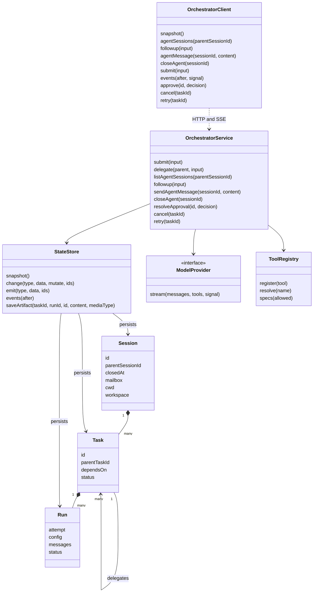

# Architecture

The runtime owns execution and persistence. TUI and web/desktop clients consume the same HTTP/SSE API. There is no UI-specific database.



## Execution

A session is a conversation with a stable cwd. Each user turn creates a task; retrying a leaf task creates a new run. A run snapshots its role and messages. Child tasks have separate sessions; parents receive structured results through `wait_tasks`. Dependencies can refer to existing siblings, avoiding cycles by construction.

Separate model and tool semaphores default to three permits each. Waiting for approvals or children holds neither permit. New-installation root budgets limit the tree to 64 tasks, depth 3, and 400 model calls; existing JSON settings retain their saved limits; each run has a five-minute deadline. Cancellation propagates to descendants. Restart resumes checkpointed runs, retains pending input, and quarantines uncertain writes; unfinished legacy runs remain interrupted.

Root sessions use the selected project cwd. Read-only children inherit cwd and only read-only tools from the intersection of parent and child capabilities. Writable children explicitly request detached Git worktrees of committed HEAD. Read-only parents cannot grant writable access. Worktrees pin their base commit and remain available for review. IntegrationQueue verifies merges in separate worktrees before an explicit apply action.

## Files and replay

`loadConfig` merges defaults, global settings, project settings, and environment overrides. Agent definitions are editable global JSON files. API secrets come from environment variables or explicit credential-file references.

StateStore holds the current state in memory. `change` clones it, applies a mutation, computes changed object fields and appended array tails, validates JSON round-trip, then appends and fsyncs a record before publishing the new state. It does not write the entire state on every change. Scoped run transactions and selected metadata reads avoid whole-state clones on hot paths. Global mutations and full client snapshots still have scaling costs.

```json
{"version":1,"event":{"seq":1,"type":"runtime.started","at":"...","data":{}},"changes":[]}
```

Records go to the initiating session's project-hash directory, or `_system/runtime.jsonl` for lifecycle events. A subtree mutation can touch multiple sessions in one record. Sequence numbers are global; replay combines all logs, checks contiguous ordering, then applies patches. Individual log files are not independently portable. Completed messages live in run-message patches; artifact bodies live in separate JSON files.

Text deltas use `emit`: live-only events with the current durable sequence and `transient: true`. They do not append records or advance the SSE reconnect cursor. Completed messages provide the durable recovery boundary.

One PID lock protects each data directory. Stale locks are reclaimed only after the owner PID is absent. A recovery claim prevents competing reclaimers; an abandoned `.reclaim` file may require manual inspection. Incomplete trailing records are backed up before truncation, after all committed records validate. Invalid committed records stop startup. Configuration uses temporary files and rename; artifact creation precedes its log reference, so a crash can leave an unreferenced artifact.

Migration reads SQLite without updating its database, writes a new staging directory, verifies replay, then renames it into a previously nonexistent destination. Legacy IDs and events survive; event wrappers have new outer sequence numbers. Old sessions keep their latest legacy cwd. Existing SQLite and workspace files remain in place.

## Boundaries

Single user and process, no encryption, compaction, independent session deletion, or distributed locking. The API exposes all sessions to authenticated clients. File tools check workspace paths; approved shell commands retain host permissions. Worktrees isolate ordinary project edits, not operating-system privileges.

Direct conversation defaults to Assistant. Explicit delegation plans are stored with the parent Task and expanded by the runtime before synthesis. Plan dependencies reference earlier entries by index. See [collaboration](COLLABORATION.md) and [TUI interaction design](TUI.md).

The CLI remains `src/main.ts`; public exports remain in `src/index.ts`. The `orchestrator/client` package export resolves to `transport/client`. Tests stay in `tests/` and import the relevant modules directly.

## Graphical client layer

The React client in `src/clients/web` uses the browser-compatible SDK and SSE stream. The WinForms/WebView2 host in `src/clients/desktop` displays the same assets and owns a bundled local runtime. The storage format and provider integration are shared with the TUI. The transport serves only explicitly allowlisted built assets from `dist/web`.

## Design patterns and current boundaries

- Provider implementations adapt model services behind the injected ModelProvider interface.
- ModelRegistry lazily creates providers from saved profiles. Each run records its selected profile, and children inherit it; changing the selection affects new turns. Both entry points share configuredModels for profile and credential persistence. Clients only receive public model metadata.
- ToolRegistry resolves explicit tool commands; capability filtering restricts the available commands per run.
- StateStore publishes events to HTTP/SSE consumers. This separates execution from rendering. Its journal supports recovery, but the current implementation still clones whole state during changes.
- OrchestratorClient is the shared transport facade for TUI, browser and desktop interfaces.
- UI components use composition. Shared approval options live in src/clients/shared/options.ts; the TUI editor, questions and workspace panels own their local interaction logic.

Scheduling, local worker lifecycle, run execution, model limits and integration now live in Scheduler, WorkerPool, RunExecutor, ModelGateway and IntegrationQueue. OrchestratorService owns the control API. TaskRepository provides scoped state operations. See [multi-agent execution](SWARM.md) for the class diagram, checkpoints and limits. The clients still coordinate several UI states; remote workers and distributed storage are not implemented.

## Source layout

```text
src/
  core/
    agents/       Role definitions, session lifecycle views, reusable context
    tasks/        Repository, validation schemas, result previews
    execution/    Scheduler, worker pool, executor and checkpoints
    workspaces/   Workspace preparation and verified integration
    domain.ts     Shared data contracts
    config.ts     Settings and role upgrades
    runtime.ts    Public service and orchestration commands
  models/         Providers, model registry and request limits
  tools/          Built-in tools and filesystem operations
  storage/        JSON/JSONL persistence, locks and artifacts
  transport/      HTTP/SSE, client SDK and static assets
  clients/
    shared/       Shared presentation helpers and task timelines
    tui/          Terminal views, navigation, input and Markdown
    web/          Browser/desktop views and styles
    desktop/      Windows shell and WebView2 host
  main.ts         Application entry point
  index.ts        Library exports
```

Session, Task and Run have separate lifetimes. Session parent links survive assignments. Lifecycle status is derived from task state plus closedAt, so it cannot drift after recovery. Session mailboxes use durable state transactions. Idle sessions require no worker. See SWARM.md for lifecycle and ownership rules.
