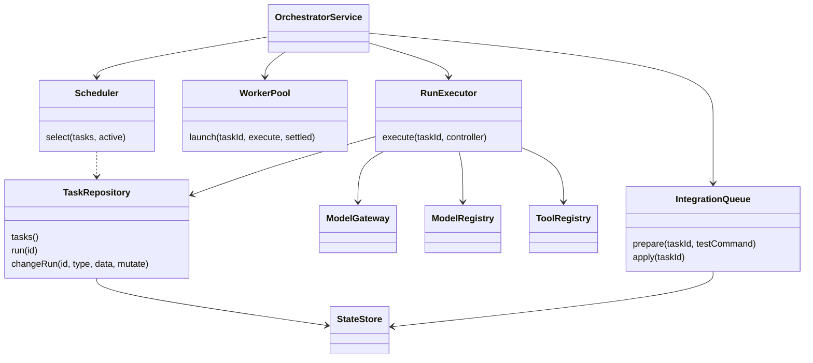

# Multi-agent execution

Orchestrator supports a local task graph with bounded execution, checkpoints, targeted
messages and explicit result acceptance. TUI, browser and desktop use the same runtime.
An agent is a role and conversation; a worker is an execution resource. Fifty tasks do
not require fifty simultaneous model requests.

## Components



Scheduler selects ready tasks, alternates root task trees and sorts priority within a
tree. WorkerPool owns local jobs and cancellation controllers. Global and per-root
admission bounds prevent unlimited live executions; waiting parents release admission
capacity. Model/tool permits are independent and are not held during questions,
approvals or child waits. ModelGateway adds per-profile concurrency and request limits.

Task parentage controls delegation, permissions, budget and cancellation. `dependsOn`
controls readiness. Queued tasks can be replanned within the same tree. Cycle checks
include implicit parent-waits-for-child edges, preventing ancestor dependency deadlocks.
Failed or rejected dependencies fail queued dependents. Cross-project dependencies are
not supported.

## Configuration

Existing settings remain unchanged. New installations default to 64 tasks and 400 model
steps per root; an older saved `maxTasks: 16` still takes precedence. Example opt-in settings:

```json
{
  "concurrency": 8,
  "maxActiveRuns": 64,
  "maxActivePerRoot": 8,
  "maxTasks": 64,
  "maxSteps": 400,
  "maxDepth": 3,
  "maxTokens": 200000,
  "runTimeoutMs": 1800000,
  "modelLimits": {
    "default": { "concurrency": 4, "requestsPerMinute": 60 }
  }
}
```

Model limits use profile IDs, not provider names. Tokens use provider-reported usage when
available, otherwise a character-based estimate. `maxTokens` stops new model steps after
the recorded budget is exhausted; concurrent in-flight requests can exceed it. It is not
a strict billing cap. Request limits and active counters are local to this runtime and
reset on restart. Transient 429/502/503/504 failures are retried at most twice before any
stream output; partial streams are not retried automatically.

## Task contracts and model selection

Submit/delegation inputs support:

```ts
{
  objective: "Implement the parser",
  agentId: "researcher",
  priority: 10,
  acceptanceCriteria: ["Existing parser tests pass", "New syntax has regression coverage"],
  requiredCapabilities: ["read_file", "apply_patch"],
  inputArtifactIds: [],
  workspace: "worktree", // delegation only
  modelId: "default",
  reviewRequired: true
}
```

Required capabilities must exist in the role, inherited allowlist and workspace policy.
Contracts and artifact references are added to the run context. Criteria describe what
the reviewer must check; the runtime does not claim that an agent's assertions prove them.
Model profiles are pinned per run. Children inherit the parent's model unless the
delegation explicitly selects another configured profile.

## Checkpoints and recovery

The durable phases are `model`, `tools`, `finalize` and `done`. Model messages and their
next phase are committed together. Completed tool receipts are persisted before the
next model call. Large results are stored as artifacts with compact receipts.

After a process crash:

- A checkpointed model step can restart from the last completed messages.
- Recorded tool results are reused rather than re-executed.
- Read-only operations without a result can be retried.
- A started mutating tool without a receipt moves the task to `needs_review`.
- Pending questions/approvals keep their IDs and decisions.
- A completed result awaiting acceptance stays in `waiting_review`.
- Legacy unfinished runs without a checkpoint remain `interrupted`.

For `needs_review`, inspect the actual workspace and record the verified tool result.
The runtime supplies that result to the agent and continues without running the uncertain
operation again. Cancel and submit corrective work if the effects cannot be established.
This does not promise exactly-once external effects: a crash can occur between an external
effect and its durable receipt.

Local execution has a generation and heartbeat lease. Stale generations cannot publish a
completed model turn. This is a single-host fence, not distributed consensus or automatic
reassignment of arbitrary unresponsive shell processes. Normal client/runtime shutdown
continues to cancel tasks; crash recovery is distinct from explicit cancellation.

## Messages and artifacts

`send_message({taskId, content})` targets an active task in the same tree. Messages are
durable and deduplicated by ID. They enter the receiver context before its next model step;
they do not interrupt an in-flight command or release a pending question/approval. The
inbox is bounded to 100 undelivered messages. Before finalizing, the executor checks for
late messages and runs another model step when needed. Finished tasks reject new messages;
submit a new user turn for additional work.

`publish_artifact({content, mediaType})` returns an artifact ID. Share this reference in
messages instead of broadcasting entire conversations. `read_artifact` retains its
session/tree access checks. Tool-generated delegation uses a durable call identity to
avoid creating duplicate children during recovery.

## Acceptance and integration

With `reviewRequired`, the final result becomes `waiting_review`. Dependents remain
blocked until a user accepts it with a decision note. Rejection fails the task and its
dependents. Approval mode `all` does not automatically accept task results.

Writable child sessions pin their Git base commit at creation. To integrate a completed
child, commit its changes inside its worktree, accept its result if required, and provide
a verification command. IntegrationQueue serializes requests:

1. Create a separate integration worktree from the current target HEAD.
2. Merge the child's commit there; leave conflicts for inspection.
3. Run the requested verification command (60-second limit) and retain its output artifact.
4. Mark the integration ready only on exit code zero with a clean integration worktree.
5. Apply only on a separate user action. Require unchanged target HEAD, clean worktrees
   and no active task writing in the target project; then fast-forward the project.

Verification commands run on the host, like `run_command`. Integrations do not push Git
history. Worktrees and conflict evidence are retained for inspection. An interrupted merge
or apply is marked `interrupted`; inspect repository state before preparing another attempt.
Pending requests in the in-process integration queue are not a distributed durable queue.

## Clients

- **TUI:** `/tasks` opens project tasks. Up/Down selects, Enter opens the task conversation.
  `P` pauses/resumes dispatch for the root, `M` sends a message, `C` cancels the subtree.
  `Y` accepts and `N` rejects a result after entering a note. `V` records a verified result
  for an uncertain operation. `I` enters an integration verification command; `F` applies
  an already verified integration.
- **Web/desktop:** the **Tasks** button opens the same project task board with status,
  dependency blockers, budgets, acceptance criteria, messages and integration controls.

Pause affects new dispatch, not model/tool work already running. Cancellation propagates
through parentage. Both clients retain the main chat as the result stream, with task
conversations available separately.

## Boundaries

The store remains a single-writer JSONL store. Scoped run transactions and metadata reads
avoid cloning all conversation histories on hot paths, but global mutations and client
snapshots still copy global state. Large-history compaction and virtualized client lists
remain future work.

Workers are local asynchronous executions, not OS processes or remote machines. Remote
worker registration, network leases, shared transactional storage, cross-host rate limits
and process/container isolation require a separate transport/storage implementation. The
current tests validate fifty local tasks with deterministic providers, not fifty external
LLM accounts or production cluster availability.


## Task-driven delegation

The default assistant handles simple requests directly and can delegate substantial independent tasks without an explicit team command. It owns the plan, bounded task descriptions, acceptance criteria, dependency graph and final synthesis. Delegation is a model decision, not a fixed fan-out on every user message. Custom agent prompts and tool restrictions remain authoritative.

Each child starts an independent session. Pass required context in the objective and reference input artifacts; parent history is not copied. Independent tasks enter the existing bounded scheduler; dependsOn gates dependent tasks. Read-only work is the default; code edits use separate worktrees and still require explicit integration.

wait_tasks returns taskId, status, a result preview (at most 1,200 characters per task and 8,000 across a batch), a truncated flag and resultArtifactId. The full report stays in the child session and artifact; read_artifact retrieves details on demand. Dependency inputs use the same bounded previews. Child reasoning and tool transcripts are not inserted into the parent conversation. Previews are excerpts, not a second model-generated summary, so child reports should lead with conclusions, evidence, tests and blockers.

If the parent tries to finish before receiving child results, the runtime waits, durably appends unseen result previews and schedules another model step for synthesis. Receipt tracking prevents repeated injection and survives restart. Explicit waits and preconfigured task plans use the same receipt tracking. Failed children retain their failure status; automatic delegation does not invent retries or claim successful integration.

Only exact previous built-in role definitions are upgraded on startup; customized prompts or allowlists are retained. Existing runs retain their captured configuration. TUI and graphical clients share this runtime behavior; full child records remain accessible in the child conversation.

## Reusable agent sessions

A child Session is a reusable agent instance identified by sessionId. agentId names its role, taskId identifies one assignment, and runId identifies an execution attempt. Completing, failing or cancelling a task leaves the session idle. Idle sessions hold no execution slot, issue no model requests and have no expiry timer. runTimeoutMs still bounds each active execution, including waits; it does not expire idle sessions.

Lifecycle: idle -> running -> waiting/running -> idle. Explicit close marks the session and its descendants closed, cancels active tasks and retains history. Closed sessions reject follow-ups, messages and retries.

Use delegate_task for the first assignment (returns taskId and sessionId), list_agents to discover existing children across parent turns, followup_task to reuse an idle session, and wait_tasks with the new taskId. Busy agents reject concurrent assignments; send_message with sessionId queues supplementary instructions. Sending a message alone does not start a turn. Pending messages survive restart and delivery is persisted atomically with the run message.

Follow-up preserves the child role, workspace, default model and existing tool restrictions. Parent history is not inherited. Context includes up to eight finished turns, capped at 96,000 serialized characters. Oversized turns use result excerpts, and cancelled tool calls without results are excluded. Full history and artifacts remain persisted. Worktree edits remain in that agent's worktree until explicitly integrated.

With an active parent, follow-up tasks attach to its task tree and share budgets and dependency rules. After the parent finishes, a user can assign a task directly in the child chat: it gets a new root task/budget while retaining the Session parent link. A later parent turn can reuse the same session. Model tools may control only direct child sessions owned by their conversation.

TUI: Ctrl+T lists reusable sessions. Open an idle child and type its next task; input while busy queues a message. Esc returns to the parent draft. /close-agent closes the child and descendants. The task board's M action queues instructions without starting work. Web/desktop shares this behavior with an idle composer, Parent navigation and Close agent button.
